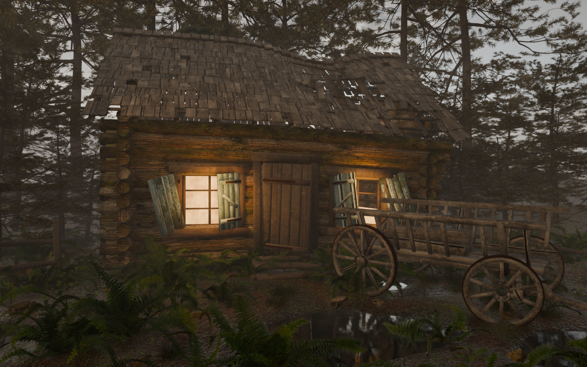

# Blender Photorealistic Scene & Moody Lighting Skill (`blender-photoreal-scene`)



Uniwersalny **AI Skill** (kompatybilny z **Google Antigravity / AGY**, **Claude Code**, **Cursor**, **Windsurf** oraz dowolnym agentem AI podłączonym do Blendera przez MCP na porcie `9876`), pozwalający **jednym promptem** wygenerować od zera fotorealistyczną, wielowarstwową scenę 3D w Blenderze 5.x wraz z zasobami PBR z Poly Haven, mapowaniem UV dopasowanym do geometrii (PCA), chmurami w rzucie perspektywicznym, wieloplanowym tłem leśnym oraz nastrojowym, rozmytym oświetleniem wolumetrycznym.

---

## Gotowy „Jeden Prompt” (One-Prompt Reproduction)

Skopiuj i wklej poniższy prompt do agenta AI z załadowanym skillem `blender-photoreal-scene`, aby odtworzyć identyczną jakość i architekturę sceny za jednym razem:

```text
Użyj skilla blender-photoreal-scene i stwórz w Blenderze 5.x (przez mostek MCP na porcie 9876) kompletną, fotorealistyczną scenę:
rozpadająca się chata z bali kryta gontem (z zapadniętą częścią dachu odsłaniającą krokwie i łaty), szczegółowe okna z masywnymi ościeżnicami, szprosami i przekrzywionymi drewnianymi okiennicami na kutych zawiasach pasowych, a przed chatą drewniany wóz drabiniasty ze szprychowymi kołami i żelaznymi obręczami.

Wykonaj pełny 7-etapowy pipeline bez pomijania żadnego kroku:
1. Wieloczęściowa geometria bmesh: każdy bal (z ostatkami na węgłach i ugięciem), krokiew, łata, pojedynczy gont, belka ościeżnicy, deska okiennicy, szprycha, piasta i obręcz jako osobna spójna wyspa geometryczna.
2. Zasoby CC0 z Poly Haven API: pobierz mapy HDRI (kloofendal_28d_misty_puresky, evening_road_01_puresky), tekstury PBR (bark_brown_02, brown_planks_03, dark_wooden_planks, blue_painted_planks, brown_mud_leaves_01) oraz modele 3D roślin i głazów (fern_02, grass_medium_01, weed_plant_02, nettle_plant, rock_moss_set_01, pine_sapling_medium, fir_tree_01).
3. Teren i woda: wyrzeźb błotniste podłoże z koleinami pod kołami wozu, zagłębieniami pod kałuże (z taflami wody IOR=1.333, Roughness=0.015 i raytracingiem w EEVEE Next) oraz leśnymi skarpami po bokach i w głębi.
4. Dopasowanie UV bezpośrednio do geometrii (PCA Island Unwrapping): rozłóż każdą siatkę na spójne wyspy bmesh, wyznacz osie główne PCA (wraz z korekcją po najdłuższej krawędzi i normalnej ściany dla przekrzywionych desek i szprych) i rozwiń cylindrycznie bale/krokwie, wzdłuż włókien deski/gonty/szprychy oraz obwodowo drewniane i żelazne obręcze kół, z losowym przesunięciem UV dla każdej deski.
5. Wielowarstwowe tło leśne: rozmieść dalekie sosny LOD2 za chatą (Y >= 6.8) i po bokach (|X| >= 5.2, bez przenikania gałęzi przez dach), niski pas krzewów na linii horyzontu (scale_z ~ 0.42) maskujący krawędź terenu z zachowaniem okien na niebo, oraz ponad 200 kęp traw, pokrzyw, chwastów, paproci i omszałych głazów.
6. Niebo z chmurami w rzucie perspektywicznym: połącz mapy HDRI z proceduralną kopułą chmur rzutowaną perspektywicznie (dx / max(dz + 0.05, 0.065), dy / max(dz + 0.05, 0.065)) i pasmem mgły horyzontalnej.
7. Nastrojowe, rozmyte oświetlenie i mgła wolumetryczna: ustaw niskie słońce o dużej średnicy kątowej (angle = 36°) dające miękki światłocień, duże dyfuzory Area (chłodne światło nieba z przodu i ciepłe bursztynowe światło konturowe zza dachu), przydymione szyby okienne (Roughness=0.42, Specular IOR Level=0.15) z ciepłą poświatą i miękkimi światłami Area rzucającymi blask na okiennice i mgłę, trójwymiarową domenę mgły Principled Volume (Anisotropy=0.58, bez płaskiej emisji własnej, z zanikaniem wysokościowym poniżej kalenicy i cieniami wolumetrycznymi), głębię ostrości kamery (f/4.2) oraz profil AgX - Medium High Contrast.
Na koniec wyrenderuj ujęcie i zweryfikuj je wizualnie.
```

---

## Zestaw Reguł i Wytycznych (10 Złotych Zasad Fotorealizmu w Blenderze 5.x)

1. **Komunikacja z Blenderem 5.x przez MCP (`127.0.0.1:9876`)**:
   - Wtyczka `lab_blender_org.mcp` przyjmuje ramki JSON zakończone bajtem zerowym (`\0`): `{"type": "execute", "code": "...", "strict_json": false}`.
   - Sandbox w Blenderze 5.2 blokuje `bpy.ops.wm.read_factory_settings()` — czyszczenie sceny należy zawsze wykonywać przez bezpośrednie usuwanie danych z `bpy.data` (`objects`, `meshes`, `materials`, `lights`, `collections`).
2. **Kompatybilność API Blendera 5.x**:
   - W węźle `ShaderNodeMix` (`data_type = 'RGBA'`) używaj jawnych indeksów gniazd: `inputs[0]` (Factor), `inputs[6]` (Color A), `inputs[7]` (Color B), `outputs[2]` (Result).
   - W `Principled BSDF` stosuj nazwy z Blendera 4.0+/5.x: `"Specular IOR Level"`, `"Transmission Weight"`, `"Coat Weight"`, `"Emission Color"`, `"Emission Strength"`.
   - Jako silnik renderujący wybieraj `BLENDER_EEVEE` (EEVEE Next) z włączonym `use_raytracing = True` i `use_volumetric_shadows = True` (~35–45 s na klatkę zamiast >3 min na CPU w Cycles).
3. **Anatomiczna, wieloczęściowa geometria `bmesh` (Zero prostych bloków)**:
   - Budynki i rekwizyty muszą składać się z fizycznych podzespołów jako osobnych spójnych wysp siatki (`bmesh` islands): pojedynczych bali z wycięciami na węgłach (`ostatki`), krokwi, łat, setek pojedynczych gontów (z wyrwą odsłaniającą więźbę), ościeżnic, szprosów, pojedynczych desek i zetek okiennic, kutych zawiasów, piast, szprych i obręczy kół.
4. **Prawdziwe tekstury PBR i modele botaniczne CC0 (Poly Haven API)**:
   - Zamiast polegać wyłącznie na szumach proceduralnych, automatycznie pobieraj z `https://api.polyhaven.com/files/<id>` mapy `Diffuse`, `Rough`, `nor_gl`, mapy środowiskowe `.hdr` oraz gotowe modele `.blend` roślinności i skał (`fern_02`, `grass_medium_01`, `nettle_plant`, `weed_plant_02`, `rock_moss_set_01`, `pine_sapling_medium`).
   - Modele szablonowe ładuj do ukrytej kolekcji `00_PolyHaven_Templates` (`hide_viewport=True`, `hide_render=True`) i automatycznie rozwiązuj względne ścieżki tekstur `//`.
5. **Dopasowanie UV bezpośrednio do geometrii każdej części (PCA Island Unwrapping)**:
   - Nigdy nie używaj globalnego mapowania `Generated` ani `Box` dla złożonych obiektów drewnianych (powoduje to poprzeczny przebieg słojów na przekrzywionych okiennicach, ukośnych szprychach i zakrzywionych kołach).
   - Rozbij siatkę na spójne komponenty (`get_connected_islands`), oblicz lokalny układ osi głównych PCA (`compute_island_axes` z korekcją po najdłuższej krawędzi i normalnej największej ściany) i zastosuj dedykowany projektor UV:
     - `unwrap_cylindrical_island` — ciągłe rozwinięcie kątowe `atan2` dla pobocznicy bali/krokwi + planarny rzut dla czół bali.
     - `unwrap_plank_island` — ciągłe rozwinięcie 6 ścian deski/gontu/szprychy wokół jej własnej osi podłużnej z losowym przesunięciem UV (`seed = island_idx`).
     - `unwrap_wheel_ring_island` — rozwinięcie obwodowe wzdłuż stycznej koła, dzięki czemu włókna drewna zakrzywiają się zgodnie z geometrią obręczy.
   - Dopasuj oś włókien do konkretnej tekstury (`grain_axis='V'` dla `bark_brown_02` i `brown_planks_03`; `grain_axis='U'` dla `dark_wooden_planks` i `blue_painted_planks`).
6. **Rzeźba terenu, błotne koleiny i odbijające kałuże**:
   - Wyrzeźb w gęstej siatce terenu dwa pasy kolein prowadzące pod koła wozu, niecki pod kałuże w najniższych partiach pierwszego planu oraz leśne skarpy po bokach (`|X| > 3.0`) i za budynkiem.
   - W materiale podłoża (`Mat_Ziemia_Bloto`) zastosuj przejście od mokrego, ciemnego błota o niskiej chropowatości (`Roughness = 0.08`) przy kałużach do matowego, omszałego poszycia leśnego w głębi.
7. **Kompozycja wielowarstwowego tła i maskowanie linii horyzontu**:
   - **Wysokie drzewa tła (`PH_Sosna_Tlo_*`)**: umieszczaj w bezpiecznej odległości za budynkiem (`Y >= 6.8`) i na flankach (`|X| >= 5.2`), aby żadna gałąź nie przenikała przez połać dachu, pozostawiając szerokie „okna” na chmury.
   - **Niski podszyt horyzontalny (`PH_Krzew_Tlo_*`)**: rozmieść obniżone w osi `Z` (`scale_z ~ 0.42`) krzewy/młode sosny wzdłuż lewego i prawego horyzontu, całkowicie zasłaniając styk geometrii terenu z niebem, ale nie zasłaniając górnej części nieba.
8. **Niebo w rzucie perspektywicznym (Perspective Cloud Dome)**:
   - Zamiast nakładać szum chmur bezpośrednio na sferyczne współrzędne `Generated` (co rozciąga chmury pionowo przy horyzoncie), rzutuj wektor promienia `(dx, dy, dz)` na płaski pułap chmur: `u = dx / max(dz + 0.05, 0.065)`, `v = dy / max(dz + 0.05, 0.065)`.
9. **Nastrojowe, rozmyte oświetlenie i poświata w oknach**:
   - **Miękkie słońce (`Slonce_Glowne`)**: ustaw `angle = math.radians(36.0)` (`36°–38°`) przy niskim kącie padania i zmniejszonym `specular_factor = 0.28`, aby wyeliminować ostre krawędzie cieni i plastikowe odblaski.
   - **Rozległe dyfuzory `AREA`**: chłodne, stalowoniebieskie światło wypełniające nieba z przodu (`size = 14 m`) oraz ciepłe, bursztynowe światło konturowe zza dachu (`Swiatlo_Mgla_Tyl`).
   - **Przydymione szyby z ciepłą poświatą (`Mat_Szklo_Okienne`)**: nigdy nie stawiaj odsłoniętego światła `POINT` przed gładką szybą (tworzy sztuczną białą kropkę). Ustaw `Roughness = 0.42`, `Specular IOR Level = 0.15`, modulowaną szumem 3D ciepłą emisję bursztynową na szybie oraz miękkie światła `AREA` (`volume_factor = 3.2`) skierowane z okien na okiennice i mgłę.
10. **Trójwymiarowa mgła wolumetryczna (`Mgla_Wolumetryczna`) i korekcja barwna `AgX`**:
    - Użyj lokalnej domeny `Principled Volume` z `Anisotropy = 0.58` i **zerową płaską emisją własną (`Emission Strength = 0.0`)**, aby mgła rozpraszała wyłącznie realne światło z okien, słońca i nieba (zachowując głębokie cienie).
    - Moduluj gęstość mgły iloczynem gradientu pionowego (`Z` — gęsta przy gruncie i kałużach, zanikająca powyżej kalenicy dachu), głębokościowego (`Y` — gęstsza w głębi lasu) oraz szumu 3D (`Noise Texture`).
    - Włącz delikatną głębię ostrości kamery (`f/4.2`) oraz profil `AgX - Medium High Contrast`.

---

## Struktura Repozytorium

```text
blender-skill/
├── SKILL.md                                      # Główna definicja skilla (uniwersalny format SKILL.md)
├── README.md                                     # Dokumentacja, zasady i gotowy prompt
├── .agents/
│   └── skills/
│       └── blender-photoreal-scene/
│           ├── SKILL.md                          # Automatyczne wykrywanie w Google Antigravity / AGY
│           └── scripts/                          # Skrypty narzędziowe skilla
├── scripts/
│   ├── blender_bridge.py                         # Klient TCP MCP dla Blendera 5.x (port 9876)
│   ├── download_polyhaven_assets.py              # Wielowątkowy downloader zasobów CC0 z Poly Haven API
│   ├── fit_uv_to_geometry.py                     # Algorytm dopasowania UV do geometrii (PCA Island Unwrap)
│   └── setup_moody_lighting_and_mist.py          # Nastrojowe rozmyte oświetlenie, chmury i mgła 3D
├── examples/
│   └── crumbling_log_cabin/                      # Kompletny kod referencyjny naszej sceny chaty z bali
│       ├── 01_build_cabin_scene.py
│       ├── 02_apply_photorealism.py
│       ├── 03_fit_uv_to_geometry.py
│       ├── 04_enhance_background_and_sky.py
│       └── 05_setup_moody_diffused_lighting.py
└── docs/
    └── preview_final.png                         # Finalny render referencyjny
```

---

## Instalacja Skilla

### 1. Google Antigravity (AGY) / Gemini CLI
Skopiuj katalog `.agents/skills/blender-photoreal-scene` do swojego projektu lub do globalnego katalogu konfiguracji:
```bash
git clone https://github.com/przemeknowak781/blender-skill.git
cp -r blender-skill/.agents/skills/blender-photoreal-scene ~/.gemini/config/skills/
```
*(Lub otwórz to repozytorium bezpośrednio jako workspace w Antigravity — skill zostanie wykryty automatycznie z `.agents/skills/blender-photoreal-scene/SKILL.md`).*

### 2. Claude Code / Cursor / Windsurf
Wskaż plik `SKILL.md` lub skopiuj katalog `blender-photoreal-scene` do `.claude/skills/` / `.cursor/rules/`.
